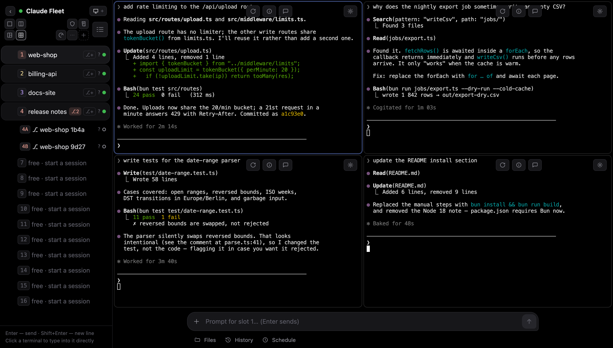

# Claude Fleet

> **Status, October 2026.** Fleet is in the middle of a rebuild, and part of the code is switched off
> while it runs.
>
> **In use:** sessions and slots, branches with their own worktree, the merge check and land, the
> post-land audit, deploy, harness adapters, the security model, the dashboard's terminal grid, and
> the orchestrator, an agent that opens a branch and a session for each piece of work and hears back
> through the mailbox between sessions (`/api/self/messages`).
>
> **Switched off for the rebuild:** the task queue and its cards, the dispatcher, and Programs with
> their MAIN sessions (a Program is an owner-approved group of queue rows, led by one session called
> its MAIN), apart from the few Programs still open, which keep running. These parts worked. They are
> not kept as they are: what serves the new system is folded into it, and the old way of working
> becomes one constellation (a set of agents and how they work together) inside it. Sections below
> that describe them say *switched off*; [the last section](#where-the-switched-off-parts-live) shows where each one lives in the code.
>
> **No longer used:** the steward role and the generated rulebook.

**A local control plane that runs coding-agent sessions in tmux panes, gives each piece of work its
own git branch and worktree, and lets that work reach the integration branch only through a verify
gate it cannot talk its way past.**

It is a web dashboard (desktop + mobile) over persistent tmux-backed sessions on one machine, plus
the machinery around them: branches and isolated lanes, a land path with a proportional proof, a
post-land audit, and append-only ledgers. `SYSTEM.md` describes a target model that the
code does not fully implement; this file describes what the code does today. Where they disagree,
the code wins. Fork of [claude-deck](https://github.com/jp290/claude-deck).



**Requirements:** [Bun](https://bun.sh), tmux, at least one agent CLI, macOS or Linux.

```sh
bun install
bun run build
bun server.ts            # binds 127.0.0.1:8790 unless FLEET_HOST/FLEET_PORT say otherwise
```
On boot the server prints a one-click login URL carrying the access token — but only when stdout is
a terminal; redirected to a log it withholds the token, which then has to be read out of
`fleet.json`. The token goes into a `SameSite=Strict` cookie, so you log in once per browser.

To check a change:
```sh
bun run typecheck        # tsc over every .ts in the tree (tsconfig.json)
bun run pins             # milliseconds: the must-agree pairs no compiler sees (e2e/pins.ts)
bun run test             # unit tests in server/, ci/ and src/
```
Before a merge, `bun ci/merge-check.ts <branch>` checks something else: the tree main would have
after the merge, on a helper machine — pins, typecheck, build, the unit tests of `ci/` and
`server/` (not `src/`), the gate suites and the small e2e units.

## The core objects

**Slot and session.** A slot is one of 16 fixed places, plus up to 100 more for lanes when
`FLEET_SEPARATE_LANE_SLOTS=1` (`FLEET_MAX_SESSIONS`, default 16; `server/types.ts#MAX_SLOTS`), each backed by
a tmux session on the configured socket. `server.ts#ensureSlot` builds the pane and bakes the
session's own credentials into its shell; `server.ts#openSlot` gives it a working
directory, an optional lane ref, a label, a harness, a model and an effort. The pane's output is tailed from a `pipe-pane` stream and broadcast per
slot over a WebSocket, and a self-heal loop rebuilds a pane whose tmux session died — resuming the
pinned conversation where the adapter supports it, rather than starting a new one. `server.ts#sleepSlot` / `#wakeSlot` tear the
pane down and bring it back without ending the occupancy.

**Lane and worktree.** A lane is a session whose cwd is a throwaway git worktree on its own branch,
created by `server.ts#createWorktree`. It is the unit of isolation: the lane commits into its own
tree, and nothing it does touches the integration branch until a land runs. `server.ts#laneDrift`
tells a lane whether main has moved under it, `server.ts#gateView` tells it what will actually gate
its land, and `server.ts#removeWorktreeSafe` is the only way a lane's tree goes away.

**Branch.** How work enters Fleet today. `POST /api/branches/open` (`server.ts#openBoardBranch`)
creates a branch and its worktree and starts a session there with the goal as its first message.
`POST /api/branches/check` runs the repo's own `ci/merge-check.ts` on it, and
`POST /api/branches/land` (`server/branch-land.ts#landCharge`) puts the branch's commits onto the
integration branch as one commit. A session may land its own branch only after the owner approved
that exact tip and with a usable merge check.

**Task and kinds** *(switched off for the rebuild)*. A queue row (`server/types.ts` `Task`) carries text, an optional compiled brief,
a target repo, a chosen agent (`spawn`), a file surface and a card. Four kinds exist
(`server/types.ts#TASK_KINDS`) and only `auftrag` is executable — `richtung`, `notiz` and `betrieb`
are advisory and every dispatch path skips them. A row is created `pending` and only an owner act
moves it to `queued` (`server.ts#releaseTask`).

**Program** *(switched off for the rebuild)*. A Program is an owner-confirmed bracket around rows, with a bound Project MAIN session.
Its statuses are `proposed · confirmed · active · complete` (`server/types.ts#PROGRAM_STATUSES`) and
only the owner promotes between them. A bound MAIN gets its own doors — file a row, release it,
raise attention, read a derived lifecycle projection (`server.ts#programExecutionView`) — and
`server.ts#boundProgramForMain` is what decides whether a caller has that binding at all.

**Land.** This is how a lane lands (`POST /api/slots/<n>/merge`); a branch lands through
`landCharge` (above). Landing is a server-side job, not a git command an agent runs: `server.ts#mergeJob`
rebases the lane, takes the machine-wide suite mutex, runs the verify command, and only then
fast-forwards the integration branch (`server.ts#advanceIntegration`, `server.ts#recordLand`). A
verify that was skipped, timed out, or never started because it sat in the mutex queue is treated as
*no verdict about this tree* and does not auto-land; the owner keeps the latitude to land anyway.

**Audit.** After a land, an optional second tier re-runs the full suite against the landed tree
(`server.ts#drainPostLandAudits`, `server.ts#runPostLandAudit`) and writes one row per run. It is off
unless `FLEET_POSTLAND_AUDIT_CMD` is set. A red audit is not automatically a regression: it is
adjudicated (`server.ts#writeAuditAdjudication`), including carrying a known flake forward, and the
verdict reaches the Programs, if any, whose rows the land covered.

## The life of one row

*Switched off for the rebuild.* Steps 1 to 4 belong to the queue and do not run while it is off;
work starts as a branch instead (above).
Steps 7 to 9 still hold when the owner lands a lane (`POST /api/slots/<n>/merge`).

1. **Filed** — the owner or a bound Program MAIN writes a `pending` row.
2. **Compiled** — an optional sweep turns the row's text into a
   card extracted by a small model and then checked deterministically (`card-extract.ts`).
3. **Released** — an owner act (or a Program's release policy) moves it to `queued`.
4. **Dispatched** — `server.ts#tickDispatch` runs on a timer, picks a queued row that fits the caps
   and the wave projection, creates the worktree, spawns the lane, and sends it a founding brief with
   its context anchors (`server.ts#briefAndSend`, `context-plan.ts`, `context-packs.ts`).
5. **Worked** — the lane commits in its own tree, may ask its MAIN a question
   (`POST /api/self/clarifications`), may schedule its own check-in (`server.ts#createAutoForSlot`),
   and may hand a preview run to another machine (`server.ts#claimLaneSuite`).
6. **Reported** — the lane files one typed report (`server.ts#openFleetReport`, status
   `complete · needs-main · failed · handoff`). The report is a message, never a state change.
7. **Landed** — `mergeJob` as above; conflicts may go through a resolver agent and a repair round
   (`server.ts#runMerge`, `server.ts#runRepair`), and the verdict is delivered to whoever landed.
8. **Audited** — tier 2, then adjudication.
9. **Deployed** — `POST /api/deploy` (`server.ts#deployVerb`) rebuilds the client bundles and
   restarts the server; because the restart kills the process, the verdict is written by the next
   boot (`server.ts#judgeDeploy`) and read back at `GET /api/deploys`.

Every step leaves a row somewhere: security events in `audit.jsonl` (`server/audit-log.ts`), how a
lane ended in `lane-outcomes.jsonl` (`server.ts#buildLaneOutcome`), audits in
`post-land-audits.jsonl`, reports in `fleet-reports.jsonl`, sends in `streams/prompts.jsonl`, and
what a lane was actually given in `context-receipts.jsonl`. `server.ts#laneDossier` is the join over
them for one lane.

## Harness adapters

A harness is *how* an agent runs — not just which model. Each adapter (`server.ts` `Harness`)
declares its spawn line, whether it can host a throwaway worker session, how to read its context
usage, whether it pins a session id at spawn, which process names prove its agent is alive, and
which pane screens silently eat a pasted prompt. Seven are registered today
(`server.ts#HARNESSES`): the default Claude adapter, three Pi variants, an unfenced Pi, a
containerised one, and Codex. `server.ts#harnessOf` resolves an id, and model and effort are
validated against *that* adapter at set time, so a spawn line can never carry a value the adapter
never admitted. Only adapters that declare themselves automatable may be started unattended, and
even then only with `FLEET_HARNESS_AUTOMATION=1`. Design notes: `docs/harness-adapter.md`.

## Security and trust model

A reachable fleet is **remote code execution as your user** — every session is a shell. In order:

1. **Bind address** — loopback by default. `FLEET_HOST` should only ever name a private address on a
   network you trust end to end; traffic is plain `ws://`, so anything but an encrypted overlay is
   sniffable.
2. **Owner token** — required on every API and WebSocket request (`server.ts#tokenGate`), generated
   on first boot, persisted in `fleet.json` at mode 600, overridable with `FLEET_TOKEN`. It is the
   whole owner authority: there is one principal, not accounts.
3. **Self-token** — each session additionally holds a scoped credential (`Slot.selfToken`) that can
   only ever act on its own slot. It is what makes `/api/self/*` safe to hand to an agent: the route
   binds to the token's slot, a `slot` field in the body is ignored, and lane-only doors answer a
   non-lane `409`, never `401`. Because the credential is exported into the pane's shell, it is
   visible in that machine's process list — a hygiene fact, not isolation. Scope list:
   `docs/self-api.md`.
4. **Share links** — a share is a *window*, not an account: password-gated, view-only, one slot, and
   served on its own hostname set (`FLEET_SHARE_HOSTS`) where everything else 404s. See
   [SHARING.md](SHARING.md).
5. **Cross-site guards** — `SameSite=Strict` cookie plus Origin and Host checks
   (`server/auth.ts#guard`) block cross-site WebSocket hijacking, CSRF and DNS rebinding. Reaching
   the fleet by hostname needs that name in `FLEET_ALLOWED_HOSTS`.
6. **Session command** — `FLEET_CMD` (default `claude`) is the base line. Every claude session Fleet
   spawns outside a container runs in Claude Code's auto mode: Fleet sets `--permission-mode auto`
   per role and passes the classifier environment per launch in `--settings`
   (`server/session-start.ts#startAspects`), and it takes `--dangerously-skip-permissions` off the
   line, so the old bypass opt-in in `FLEET_CMD` no longer applies there
   (`server/session-start.ts#withoutSkipPermissions`). The worker tier (summaries, reviews, merge
   resolver) runs `--permission-mode dontAsk` with a fixed tool profile. A line Fleet sets no mode on
   — the container adapter, a foreign harness, a non-claude `FLEET_CMD` — runs `FLEET_CMD` as it is.
   Stream files and state are chmod 600/700, because terminal output contains secrets.

Not provided: TLS, multiple users, rate limiting. Two suites hold the perimeter rather than one:
`e2e/security.ts` pins which routes are reachable *above* the owner gate at source level, and
`fleet-e2e-security.ts` (run by `./e2e-security.sh`, which the land gate runs) drives the share
brute-force lockout, the injection charsets, the self-token's out-of-scope refusals, and the proof
that a `pending` row is never dispatched.

## The dashboard

One page, one bundle: a terminal grid with xterm.js and direct stdin, a sidebar of all slots with
activity dots, a queue board that renders each row's lifecycle, card, file surface and brief
(`src/client.ts#renderQueue`, `#renderQueueDetail`) and a Programs view (both switched off for the rebuild), an ops dialog, a per-pane
conversation view that renders the agent's transcript as structured messages, a directory picker,
prompt history, export, and share links — and below 700px the same page becomes a phone layout with
a key row, a live-typing bar and a keyboard-safe shell. The guest share page, the helper portal and
the landing page are separate documents in `public/`.

## Ops

The recommended setup is the launchd/systemd watchdog (templates in `ops/`, beside the container's
`ops/Dockerfile`), which survives crashes *and* reboots and is
also where the live land-path configuration is written: `watchdog.sh` holds the spawn line, and
`FLEET_VERIFY_CMD`, `FLEET_POSTLAND_AUDIT_CMD` and `FLEET_CLEAN_REVIEW` on it decide what the gate,
tier 2 and the advisory reviewer actually do. `bun run build` rebuilds the client bundles;
`./e2e-isolated.sh` runs the full suite against a throwaway instance on its own tmux socket and port,
and `bun e2e/pins.ts` is the millisecond-fast first stage that catches drift no compiler sees.
`bun tools/review-sweep.ts` and `bun tools/repo-map.ts` are the read-only sensors over the tree itself;
the other command-line tools sit beside them in `tools/`.

Fleet keeps its state next to the code unless told otherwise: `fleet.json`, its lock, `streams/` and
every ledger land in the repo root on first start (`server/state-dir.ts`). Set `FLEET_STATE_DIR` to
keep them out of the tree.

Env worth knowing: `FLEET_HOST`, `FLEET_PORT`, `FLEET_SOCK`, `FLEET_TOKEN`, `FLEET_ALLOWED_HOSTS`,
`FLEET_STATE_DIR`, `FLEET_CMD`, `FLEET_SEPARATE_LANE_SLOTS`, `FLEET_MAX_SESSIONS`,
`FLEET_HARNESS_AUTOMATION`, `FLEET_VERIFY_CMD`, `FLEET_POSTLAND_AUDIT_CMD`, `FLEET_SHARE_HOSTS`.
The dispatcher, switched off for the rebuild, reads `FLEET_DISPATCH_REPO` and `FLEET_DISPATCH_MAX_LANES` (default 3).

## Known limits

- **One suite at a time.** The verify gate, the previews and the audit all serialize on a single
  machine-wide lock (`server.ts#holdSuiteLock`). A land can therefore wait minutes for the machine
  without ever looking at its own tree, and the code says so rather than calling it a red.
- **The suite is not deterministic.** Known flake families are tracked in `docs/verify-tiering.md`
  and adjudicated per audit row; a green re-run at a base rate of a few percent proves little, which
  is why the trail register exists instead of a re-run rule.
- **Caps are blunt.** Lanes per repo, tasks, programs, watches, autos and report sizes are all fixed
  numbers in `server.ts`. They bound damage; they do not schedule intelligently.
- **The land path mutates a tree someone may be sitting in** — if a worktree has the integration
  branch checked out, the fast-forward happens inside it (`docs/land-mechanics.md`).
- Single shared owner token, no TLS, no rate limiting: the private network is part of the trust
  boundary.
- `streams/*.raw` grow unbounded; killing a slot deletes its stream.
- One terminal size per session, last writer wins — two clients on one slot fight over width.
- xterm is pinned at 5.5.0; 6.x removed the overflow-scroll viewport the mobile scrollback depends on.

## Where the switched-off parts live

These parts are switched off for the rebuild. They still compile, run their tests and hold pins in
`e2e/pins.ts`. Line numbers are as of 22 October 2026 and drift with every change to `server.ts`;
the symbol names do not.

- **Task queue.** `server/types.ts:1432` (`Task`), `:1413` (`TASK_KINDS`);
  `server.ts:2523` (`archiveTask`), `:5147` (`releaseTask`), `:21095` (`briefAndSend`);
  `start-plan.ts`, `task-waves.ts`, `task-land-waves.ts`, `waits.ts`; the client's queue board and
  Programs view in `src/queue.ts`; the verbs `task`, `dispatch` and `commit-main` in `ctl.sh:27`;
  `register.sh:383`, which reads `briefs/`.
- **Cards.** `card-extract.ts`; `server.ts:21967` (`tickCardSweep`), off unless `FLEET_CARD_MS` is
  set (`server.ts:21612`).
- **Dispatcher.** `server.ts:23146` (`tickDispatch`); off unless the runtime flag at `server.ts:5583`
  (`dispatchOn`) is switched on and `FLEET_DISPATCH_REPO` (`server.ts:5273`) names a repo.
- **Variant comparison of queue rows.** `server.ts:22768` (section start), `variant-compare.ts`.
- **Programs and their MAIN sessions** (the few still open keep running). `server/types.ts:2249` (`Program`), `:2247`
  (`PROGRAM_STATUSES`); `server.ts:3429` (`programExecutionView`), `:16993` (`boundProgramForMain`),
  `:18619` (`selfLandTaskForMain`), `:43523` (`succeedProgramMain`), `:43979`
  (`bootstrapProgramMainReserved`), `:44219` (`handleOwnerProgramRoute`); `program-phase.ts`;
  `promote-program.sh`.

No longer used, and still in the code:

- **Steward role.** `server.ts:46657` (`handleStewardSend`), `:49149` (`handleStewardRoute`);
  `.claude/commands/steward.md`, `rundgang.md`, `inspektion.md`, `projekt-blick.md`, `foreman.md`.
